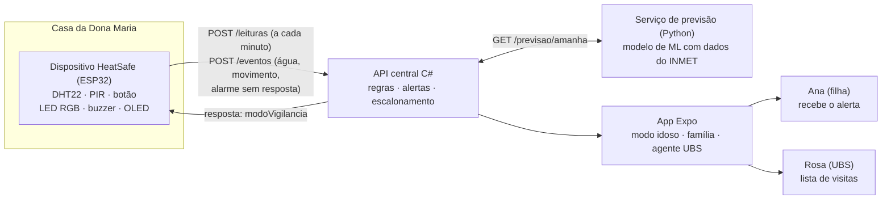
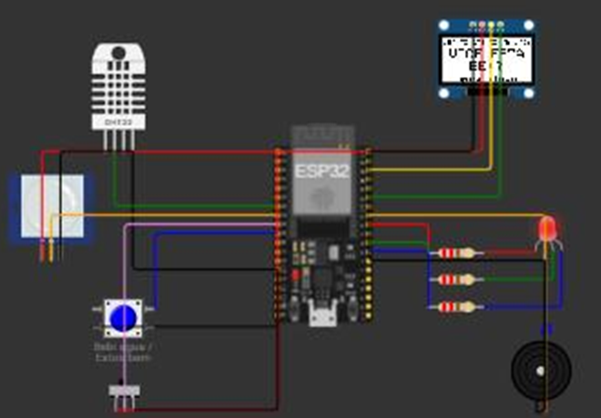
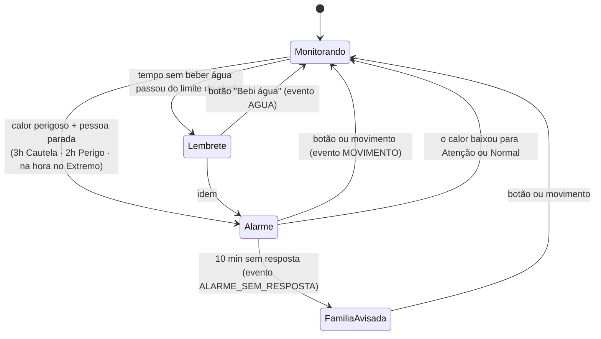

# HeatSafe · Dispositivo IoT (ESP32)

> **GS CitizenTech 2026.2 · Physical Computing: IoT & IoB · Engenharia de Software 3º ano Fev · FIAP**
> Tema: **calor extremo**. A parte física do HeatSafe: o aparelho que fica dentro da casa do idoso.

| Entrega | Link |
|---|---|
| Projeto no Wokwi | https://wokwi.com/projects/480247942666198017 |
| Vídeo demonstrativo (até 4 min) | `COLE AQUI O LINK DO YOUTUBE` · arquivo no repositório: [`HeatSafe_video_demo.mp4`](HeatSafe_video_demo.mp4) |
| Integrantes | [`integrantes.txt`](integrantes.txt) |

---

## 1. O problema que este circuito ajuda a resolver

> *Nos dias de calor extremo, idosos que passam o dia sozinhos em casas quentes podem passar mal sem perceber o risco, e ninguém fica sabendo a tempo.*

São Paulo já tem termômetro de rua, SMS da Defesa Civil e aplicativo de clima. Todos medem o calor **na rua** e dependem de a pessoa **ler e agir**. O HeatSafe resolve o que eles não resolvem, e **o ESP32 é a peça que torna isso possível**:

- **Mede o calor dentro da casa**, onde a telha de fibrocimento deixa o ar mais quente do que o relógio da rua mostra.
- **Percebe se a pessoa está se movimentando**, sem câmera e sem microfone.
- **Não exige que o idoso use celular:** tudo é passivo, com um único botão.

Sem o dispositivo, o resto do HeatSafe (API, app, lista de visitas da UBS) não teria de onde tirar o dado mais importante: *como está a casa e a pessoa agora*.

### Cada componente responde a algo que ouvimos nas entrevistas

| O que ouvimos (personas) | Quem disse | O que o circuito faz |
|---|---|---|
| "Aqui dentro de casa é sempre mais quente do que eles dizem." | Dona Maria | **DHT22** mede temperatura e umidade **dentro da casa**; o ESP32 calcula o **índice de calor** (fórmula da NOAA). |
| "Fiquei tonta, sentei no sofá e só acordei com o telefone tocando." | Dona Maria, Seu José | **Sensor PIR** guarda o horário do último movimento. Calor alto + muito tempo parada = **alarme "Você está bem?"**. |
| "Se não tiver câmera, eu aceito." · "Vai gravar o que eu falo?" | Dona Maria, Seu José | Só sensor de presença infravermelho: **não grava imagem nem som**. |
| "Não sinto muita sede… evito beber água por causa do remédio." | Dona Maria, Ana | **Lembrete de água** (LED azul, bipe e tela) e **botão "Bebi água"**. |
| "Um botão só eu consigo." | Dona Maria | **Um único botão**: normalmente é "Bebi água"; com o alarme tocando, vira "Estou bem". |
| "Esses aplicativos eu não sei mexer, e as letras são muito pequenas." | Dona Maria | **Display OLED** com o número grande, texto curto e ícones; **LED** na cor do risco; **buzzer**. |
| "Se o celular apitar toda hora, eu vou acabar ignorando." | Ana, Seu José | O alarme só toca quando **calor perigoso E pessoa parada**. Nada de apito à toa. |
| "Muita casa aqui não tem Wi-Fi bom." | Rosa (UBS) | **O alarme local funciona sem internet** e os dados ficam numa **fila** até a conexão voltar. |

---

## 2. Onde o ESP32 entra no HeatSafe



1. **O dispositivo decide sozinho o que é urgente** (computação na borda): cor do LED, lembrete de água e alarme não dependem da internet.
2. **A API decide quem avisar:** com a leitura e os eventos, ela avisa a família e, sem confirmação em 20 minutos, coloca a casa no topo da lista de visitas da UBS.
3. **O ML avisa na véspera:** quando o modelo prevê dia perigoso, a API pode responder `{"modoVigilancia": true}` e o aparelho mostra **VIGIL** e encurta o lembrete de água em Atenção de 2h para 1h.

---

## 3. O circuito


<sub>Circuito no Wokwi com o alarme "Você está bem?" tocando (34 °C, 60%, 2h sem movimento).</sub>

| Componente | Pino do ESP32 | Para que serve |
|---|---|---|
| DHT22 (temperatura e umidade) | GPIO 32 | Calor dentro da casa → índice de calor |
| Sensor PIR (presença) | GPIO 33 | Horário do último movimento |
| Botão azul | GPIO 26 (pull-up interno, liga no GND) | "Bebi água" / "Estou bem" |
| LED RGB (cátodo comum) + 3 resistores de 220 Ω | R GPIO 18 · G GPIO 17 · B GPIO 16 | Cor do nível de risco; azul = lembrete de água |
| Buzzer | GPIO 19 | Bipes, aviso de perigo e sirene |
| Display OLED SSD1306 128×64 (I2C 0x3C) | SDA GPIO 21 · SCL GPIO 22 | Índice de calor, nível, dica, alarmes |
| Chave deslizante "internet" | GPIO 25 (um lado no 3V3, outro no GND) | **Só para a demonstração:** simula a internet caindo |

### Níveis de risco (iguais na API, no app e nos testes do Azure)

| Índice de calor | Nível | LED | Lembrete de água | Alarme "Você está bem?" |
|---|---|---|---|---|
| < 27 °C | `NORMAL` | verde | — | — |
| 27–32 °C | `ATENCAO` | amarelo | a cada 2h (1h no modo vigilância) | — |
| 32–41 °C | `CAUTELA_EXTREMA` | laranja | a cada 1h | se **3h** sem movimento |
| 41–54 °C | `PERIGO` | vermelho + 3 bipes ao entrar | a cada 1h | se **2h** sem movimento |
| ≥ 54 °C | `PERIGO_EXTREMO` | vermelho piscando | a cada 1h | **na hora**; depois, bipe a cada 5 min |

Se o alarme toca e **ninguém responde em 10 minutos** (nem botão, nem movimento), o ESP32 envia o evento `ALARME_SEM_RESPOSTA`. A API então avisa a família e, sem confirmação em 20 minutos, a UBS. Para evitar que o nível "pisque" quando o índice fica na fronteira, ele só desce depois de cair 0,5 °C abaixo do limite.

### Como o dispositivo se comporta



### O que aparece no display

| Tela | Quando |
|---|---|
| **Principal:** índice de calor grande, temperatura e umidade, faixa do nível alternando com uma dica ("BEBA AGUA", "ABRA AS JANELAS", "MOLHE A NUCA"…), tempo sem movimento, tempo sem água e copos do dia | Sempre que não há alerta |
| **Hora de beber água** com uma gota pulsando | Lembrete ativo |
| **"VOCÊ ESTÁ BEM?"** piscando, com a contagem até avisar a família | Alarme de inatividade |
| **Resumo de hoje** (copos, lembretes atendidos, movimentos, pior calor) | 4 s a cada 20 s |
| Barra superior: relógio, **VIGIL** (modo vigilância), mensagens na fila e sinal do Wi-Fi | Sempre |

---

## 4. Integração com a API (contratos do grupo)

O ESP32 segue exatamente os contratos combinados com a API C#.

**`POST /leituras`** — a cada minuto e imediatamente quando o nível muda:
```json
{ "dispositivoId": "HS-001", "temperatura": 34, "umidade": 60, "indiceCalor": 42.2,
  "nivel": "PERIGO", "movimento": false, "dataHora": "2026-11-12T14:00:00" }
```

**`POST /eventos`** — ao apertar o botão, ao detectar movimento (no máximo 1 a cada 10 min) e quando o alarme fica sem resposta:
```json
{ "dispositivoId": "HS-001", "tipo": "ALARME_SEM_RESPOSTA", "dataHora": "2026-11-12T14:05:00" }
```
Tipos: `AGUA`, `MOVIMENTO`, `ALARME_SEM_RESPOSTA` e, como extensão proposta para o indicador de hidratação, `LEMBRETE_AGUA` (dá para desligar com `ENVIAR_LEMBRETES_PARA_API 0`).

Todas as requisições levam os cabeçalhos `Content-Type: application/json` e `X-Api-Key`.

### Funciona mesmo com internet ruim

- **Duas tarefas em paralelo (FreeRTOS):** o `loop()` lê sensores, decide e avisa; uma tarefa separada, no outro núcleo do ESP32, cuida do Wi-Fi e do HTTP. **A rede nunca trava o alarme.** A tarefa de rede tem prioridade 0 para que a criptografia do HTTPS não deixe o *watchdog* sem resposta (o que reiniciaria o ESP32).
- **Fila de envio:** sem internet, leituras e eventos ficam guardados (até 40) **com o horário original** e sobem quando a conexão volta.
- **Reenvio inteligente:** falha de rede ou erro 5xx → tenta de novo esperando 2, 4, 8… até 30 s. Erro 4xx (a API recusou o dado) → descarta para não travar a fila.

---

## 5. O lado IoB (Internet of Behaviors)

O HeatSafe não olha só para o ambiente (IoT): ele acompanha **comportamentos** que indicam risco e usa isso para mudar o comportamento da pessoa.

| Comportamento | Como é captado | Como vira ação |
|---|---|---|
| Hidratação | Botão "Bebi água" e lembretes emitidos/atendidos | Lembretes mais frequentes conforme o calor; indicador "% de lembretes atendidos" |
| Atividade | Sensor PIR e tempo desde o último movimento | Alarme de inatividade e alerta para a família/UBS |
| Resposta a alertas | Botão ou movimento depois do alarme | Escalonamento só quando a pessoa não responde |

O aparelho mostra um **resumo do dia** no display e registra no monitor serial, a cada hora, linhas como:
```
[13:00] IoB       Resumo: 2 copo(s) | lembretes atendidos 1/2 | 6 movimentos | 0 alarme(s) | pior IC 42.2 C | API: 18 enviadas
```
Esses dados abastecem os indicadores de impacto da Ficha da CitizenTech.

---

## 6. Como rodar no Wokwi

1. Acesse [wokwi.com](https://wokwi.com), clique em **New Project → ESP32**.
2. Substitua o conteúdo de `sketch.ino` pelo arquivo [`wokwi/sketch.ino`](wokwi/sketch.ino).
3. Na aba `diagram.json`, cole o conteúdo de [`wokwi/diagram.json`](wokwi/diagram.json).
4. Clique na setinha ao lado das abas → **New file…** → `libraries.txt` e cole [`wokwi/libraries.txt`](wokwi/libraries.txt).
5. Clique em **▶ Start**. Salve (**Save**) e copie o link para colocar no topo deste README.

Os fios entram como linhas retas. Se quiser deixá-los mais organizados, arraste-os no editor; isso não muda o funcionamento.

### Para onde os dados vão

No topo do `sketch.ino`, em `API_BASE_URL`:

| Opção | Quando usar |
|---|---|
| `http://httpbin.org/anything` (padrão) | Funciona sem configurar nada; a resposta devolve o JSON enviado |
| `http://webhook.site/<seu-id>` | **Recomendado para o vídeo:** abra webhook.site, copie sua URL (trocando `https` por `http`) e veja cada requisição chegar ao vivo |
| URL da API C# do grupo | Com a API rodando no PC, exponha com `ngrok http 5000` (ou dev tunnels do Visual Studio) e cole a URL pública, com `http://` |

> **No Wokwi, use `http://`.** Testamos com `https://` e o simulador não conclui o handshake TLS a tempo: todo envio falha com `connection refused`. O código aceita `https://` normalmente (é o que vai no aparelho de verdade, ver seção 8).

### Modo demo (tempo acelerado)

Com `MODO_DEMO 1`, **1 segundo real = 2 minutos na casa** e o relógio começa em **12/11/2026 às 10:50**, o dia da história da Dona Maria. Assim "2 horas sem movimento" acontecem em 1 minuto. Com `MODO_DEMO 0`, o aparelho usa o tempo real e pega a hora pela internet (NTP).

### Valores para simular a casa esquentando

Clique no DHT22 com a simulação rodando e ajuste os controles:

| Temperatura | Umidade | Índice de calor | Nível |
|---|---|---|---|
| 24 °C | 50% | 23,8 °C | Normal |
| 28 °C | 60% | 29,5 °C | Atenção |
| 31 °C | 60% | 34,9 °C | Cautela extrema |
| 34 °C | 60% | 42,2 °C | Perigo (o "42 °C" da história) |
| 38 °C | 60% | 55,0 °C | Perigo extremo |

Outros controles: **clique no PIR** para simular movimento · **clique no botão azul** (ou aperte a barra de espaço) para "Bebi água" / "Estou bem" · **chave deslizante** liga e desliga a internet (para a esquerda = internet ligada; para a direita = sem internet).

---

## 7. Qualidade e testes

- **Autoteste ao ligar:** o ESP32 confere a fórmula do índice de calor e a classificação de nível contra 7 casos calculados em Python sobre os dados reais do INMET (estação A701). O resultado aparece no monitor serial (`Indice de calor e niveis: 7/7 casos OK`).
- **Mesma fórmula em todo o HeatSafe:** é a mesma regressão de Rothfusz/NOAA do `preparar_dados.py` usado pelo ML, então o "42 °C" do dispositivo, da API e do modelo significam a mesma coisa.
- **Leitura inválida é rejeitada:** umidade fora de 0–100% ou temperatura fora de −40 a 80 °C não é enviada. Depois de 3 falhas seguidas, o LED pisca roxo e o display mostra "SENSOR SEM LEITURA".
- **Sem `delay()` no fluxo principal:** sons, LED e display são atualizados por tempo (`millis()`), então o botão e o sensor respondem mesmo com a sirene tocando.

Os critérios de aceite do Azure Boards (disciplina de Testing) podem ser conferidos direto no Wokwi: *índice de 42 °C + 2h sem movimento → alarme e `ALARME_SEM_RESPOSTA` após 10 min sem resposta*; *umidade de 150% é rejeitada*.

---

## 8. Segurança e privacidade

- **Sem câmera e sem microfone.** O PIR só percebe calor em movimento.
- **Nenhum dado pessoal sai do aparelho:** só o `dispositivoId`. Nome, endereço e saúde ficam na API, com acesso restrito à família e à UBS.
- **Rotina de presença é dado sensível** (revela quando a pessoa está sozinha): por isso, no aparelho real, vai só por HTTPS e com `X-Api-Key`.
- **Limitação do protótipo:** no Wokwi a demonstração usa `http://`, porque o simulador não conclui o handshake HTTPS a tempo. Quando roda com `https://`, o certificado não é validado (`setInsecure()`). Numa versão real, o aparelho usaria só HTTPS, com o certificado da API gravado nele e uma chave única por dispositivo.

## 9. Limitações e próximos passos

- Numa versão real, **chip GSM/4G** para casas sem Wi-Fi e **bateria** para quedas de energia.
- O PIR percebe movimento, não queda; um acelerômetro numa pulseira poderia complementar.
- Calibrar os tempos (2h, 3h, 10 min) com a equipe da UBS depois de um piloto.

---

## Estrutura desta pasta

```
Physical Computing IoT e IOB/
├── README.md            ← este arquivo
├── integrantes.txt      ← nomes do grupo (entregável)
├── ROTEIRO_VIDEO.md     ← roteiro do vídeo de 4 min
├── prompts.md           ← registro do uso de IA (regra da GS)
├── HeatSafe_video_demo.mp4 ← vídeo da demonstração (3min56, com narração)
├── docs/circuito.png    ← print do circuito no Wokwi
├── wokwi/
│   ├── sketch.ino       ← firmware do ESP32
│   ├── diagram.json     ← circuito
│   └── libraries.txt    ← bibliotecas
└── dados/dados-inmet/   ← dados reais do INMET (usados pelo ML e no autoteste)
```
